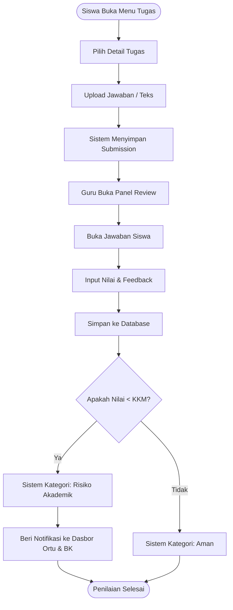
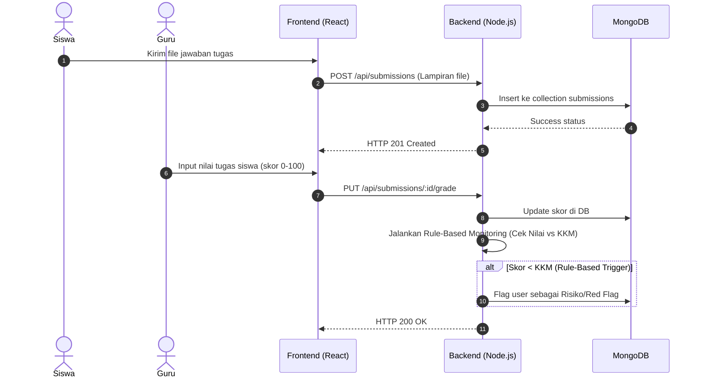

# LAPORAN TUGAS AKHIR: LMS DENGAN MONITORING BELAJAR

Berdasarkan analisis menyeluruh terhadap struktur *source code* dan dokumen sistem yang telah diberikan, berikut adalah output sesuai dengan 7 poin yang Anda minta.

---

## BAGIAN 1: Audit Sistem Berdasarkan Source Code

Dari penelusuran *source code* dan *database schema* (MongoDB), berikut adalah kondisi nyata aplikasi Anda:

1.  **Pengguna & Hak Akses (Role)**
    *   Sistem menggunakan 8 role pada schema `User.js`: `admin`, `super_admin`, `wakil_kurikulum`, `guru`, `bk`, `siswa`, `ortu`.
    *   **Catatan Penting**: Role `Wali Kelas` **tidak ada di dalam enum role database**. Kemungkinan besar, *Wali Kelas* diakomodasi melalui role `guru` yang ditugaskan (*assigned*) ke entitas `Class` (misal lewat field `homeroom_teacher` pada `Class.js`). Ini perlu diverifikasi agar penjelasan saat sidang tidak bertentangan.
2.  **Manajemen Data Pendukung Akademik (Pondasi)**
    *   Terdapat entitas `Class`, `Subject`, `AcademicYear`, dan `Schedule`. Ini adalah fondasi wajib agar LMS bisa berjalan dengan benar dan mendistribusikan materi/tugas ke target yang tepat.
3.  **Aktivitas Pembelajaran (Inti LMS)**
    *   **Materi**: Diakomodasi pada `Material.js` (dengan *file_url* dan *external_link*) dan progressnya dicatat pada `MaterialProgress.js`.
    *   **Tugas**: Diakomodasi pada `Assignment.js` dan pengumpulannya pada `Submission.js` (mendukung teks dan file).
    *   **Kuis & CBT**: Diakomodasi pada `QuizBank.js`, `QuizSubmission.js`, `CbtExam.js`, dan `CbtResult.js`. CBT dirancang lengkap dengan *timer*, waktu mulai/selesai, dan otomatisasi penilaian.
    *   **Penilaian**: Diakomodasi melalui `Grade.js` (menyimpan nilai UTS, UAS, dan akhir) serta `Rapor.js`.
    *   **Presensi**: Diakomodasi melalui `Attendance.js` (per jadwal) dan `DailyAttendance.js`.
4.  **Monitoring Belajar (Rule-Based)**
    *   Sistem murni menggunakan logika **Rule-Based**. Contoh nyata dari sistem: *Red Flag BK* apabila Alpa $\ge$ 3 hari, atau rekap nilai di bawah KKM. Tidak ada modul atau *library* Machine Learning yang digunakan.

---

## BAGIAN 2: Perbedaan BAB I Lama dengan Kondisi Sistem

> **[INFO]** Karena Anda belum melampirkan file BAB I dan BAB II versi lama, saya berfokus pada potensi ketidaksesuaian (*mismatch*) yang umumnya terjadi berdasarkan deskripsi Anda:

1.  **Penyebutan Role**: Pastikan dokumen lama tidak menulis *Wali Kelas* sebagai role independen secara sistem (RBAC) jika sistem menganggapnya sebagai `guru` yang memiliki relasi ke sebuah `Class`. **[PERLU VERIFIKASI]**
2.  **Klaim AI/Machine Learning**: Jika bab lama memuat istilah seperti "prediksi kelulusan", "klasifikasi masa depan", "AI", atau "Random Forest", **segera hapus**. Ganti dengan istilah *Rule-Based Classification* atau *Sistem Peringatan Dini (Early Warning System) Berbasis Aturan*.
3.  **Kesan SIAKAD**: Jika bab lama terlalu banyak membahas modul "pendaftaran siswa", "pembayaran SPP", atau "penggajian guru", hal itu harus dihapus karena fokus aplikasi Anda adalah **Learning Management System (LMS)**.

---

## BAGIAN 3: BAB I (Pendahuluan) - Versi Revisi

### 1.1 Latar Belakang
Pendidikan di era digital menuntut adanya integrasi teknologi untuk mengoptimalkan proses kegiatan belajar mengajar (KBM). Transformasi dari metode konvensional menuju digitalisasi KBM bukan sekadar memindahkan materi ke dalam bentuk digital, melainkan memastikan bahwa seluruh siklus pembelajaran—mulai dari penyampaian materi, penugasan, evaluasi, hingga presensi—dapat terkelola secara sistematis. 

Permasalahan utama yang sering terjadi di tingkat sekolah menengah, khususnya SMP, adalah terpecahnya platform pembelajaran (misalnya menggunakan aplikasi pesan singkat untuk komunikasi, layanan *cloud* untuk tugas, dan form daring untuk ujian). Hal ini menyulitkan pihak sekolah dalam melakukan sentralisasi data. Selain itu, keterbatasan visibilitas dalam memantau perkembangan belajar siswa menjadi kendala signifikan. Guru kesulitan mendeteksi penurunan performa siswa secara dini, sedangkan orang tua dan Bimbingan Konseling (BK) sering kali baru mengetahui masalah akademik atau presensi (seperti sering membolos) pada saat pembagian rapor akhir semester. 

Berdasarkan permasalahan tersebut, dibutuhkan sebuah wadah digital terintegrasi berupa *Learning Management System* (LMS). LMS ini dirancang secara mandiri (*standalone*) untuk mengakomodasi kebutuhan spesifik sekolah. Berbeda dengan aplikasi akademik administratif (SIAKAD), LMS berfokus penuh pada aktivitas pembelajaran. Data akademik seperti kelas, mata pelajaran, dan jadwal digunakan semata-mata sebagai fondasi pendukung agar distribusi KBM tepat sasaran. 

Sebagai solusi atas permasalahan pemantauan siswa, LMS ini dilengkapi dengan fitur *Monitoring Belajar Siswa* berbasis aturan (*Rule-Based Monitoring*). Fitur ini bekerja dengan mengevaluasi data KBM (seperti tingkat kehadiran, pemahaman materi, nilai kuis, dan nilai tugas) berdasarkan parameter standar ketuntasan belajar yang ditetapkan oleh pihak sekolah. Dengan adanya pemantauan *rule-based* ini, sistem dapat memberikan peringatan dini (*early warning*) atau *red flag* kepada pihak-pihak terkait, sehingga intervensi akademik dari guru, BK, maupun orang tua dapat dilakukan lebih awal dan tepat sasaran.

### 1.2 Rumusan Masalah
1. Bagaimana merancang dan membangun sebuah *Learning Management System* (LMS) yang mengintegrasikan proses penyampaian materi, penugasan, kuis, ujian *Computer Based Test* (CBT), serta presensi dalam satu platform digital?
2. Bagaimana mengimplementasikan metode *Rule-Based* untuk memonitor perkembangan belajar siswa secara *real-time* sehingga dapat memberikan informasi kondisi akademik kepada Guru, Wali Kelas, BK, dan Orang Tua?

### 1.3 Batasan Masalah
1. Sistem ini adalah *Learning Management System* (LMS) yang berfokus pada pelaksanaan proses pembelajaran, bukan sistem informasi akademik (SIAKAD) penuh. Data pendukung seperti data pengguna, kelas, mata pelajaran, dan jadwal diintegrasikan hanya sebagai syarat berjalannya modul LMS.
2. Fitur monitoring belajar berfokus pada pengelompokan kondisi siswa berdasarkan aturan (*Rule-Based*) yang ditetapkan dari ambang batas nilai (KKM), progress materi, dan jumlah presensi, tanpa menggunakan algoritma *Machine Learning*.
3. Hak akses (role) yang terlibat dalam sistem adalah Super Admin, Admin TU, Wakil Kurikulum, Guru, BK, Siswa, Orang Tua, dan Alumni. Role Wali Kelas direpresentasikan oleh Guru yang memiliki tanggung jawab pada kelas tertentu.

### 1.4 Tujuan
1. Merancang dan membangun *Learning Management System* (LMS) yang mampu memfasilitasi kebutuhan KBM digital, mulai dari distribusi materi, pengelolaan tugas, ujian CBT, hingga pencatatan presensi siswa secara terpusat.
2. Mengembangkan modul monitoring belajar berbasis aturan (*Rule-Based*) yang memberikan kemudahan pemantauan secara objektif dan sistematis bagi guru, pihak sekolah, serta orang tua.

### 1.5 Manfaat
1. **Bagi Sekolah**: Memiliki platform pembelajaran tersentralisasi yang memudahkan proses audit akademik dan pemantauan efektivitas KBM.
2. **Bagi Guru**: Mempermudah distribusi materi, mengotomatisasi penilaian CBT, serta membantu mengidentifikasi siswa yang membutuhkan perhatian khusus sedini mungkin.
3. **Bagi Siswa**: Memberikan fleksibilitas dalam mengakses KBM dan memberikan transparansi mengenai progres pembelajaran mereka sendiri.
4. **Bagi Orang Tua**: Memberikan akses secara *real-time* untuk memantau performa dan tingkat kehadiran anak tanpa harus menunggu periode pembagian rapor.
5. **Bagi Peneliti**: Mengaplikasikan keilmuan rekayasa perangkat lunak dalam memecahkan masalah nyata pada sektor pendidikan.

### 1.6 Sistematika Penulisan
*(Sesuaikan dengan pedoman penulisan kampus Anda. Contoh standar: Bab I Pendahuluan, Bab II Tinjauan Pustaka & Dasar Teori, Bab III Metodologi Penelitian/Analisis Sistem, Bab IV Implementasi dan Pengujian, Bab V Penutup).*

---

## BAGIAN 4: BAB II (Gambaran Produk / Sistem yang Dibangun)

### 2.1 Gambaran Umum Produk
Produk yang dibangun adalah sebuah *Learning Management System* (LMS) berbasis web untuk sekolah tingkat pertama (SMP). LMS ini didesain sebagai ekosistem digital mandiri yang memfasilitasi interaksi akademik. Semua proses konvensional, mulai dari pemberian bahan ajar, pengerjaan tugas, pelaksanaan kuis interaktif, hingga evaluasi ujian (CBT) dan presensi, ditransformasi ke dalam bentuk aplikasi yang dapat diakses oleh semua pemangku kepentingan (*stakeholders*) sekolah secara daring.

### 2.2 Tujuan dan Fungsi Produk
Tujuan produk adalah mendigitalisasi proses KBM secara end-to-end dengan penekanan pada transparansi perkembangan siswa. Secara fungsi, sistem bukan berfungsi sebagai Sistem Informasi Akademik (SIAKAD) untuk urusan kepegawaian atau registrasi PPDB. Produk ini 100% berfokus pada **jalur pembelajaran (Learning Path)**. Kehadiran data akademik (seperti Tahun Ajaran dan Rombongan Belajar) berfungsi sebagai parameter pengikat agar materi yang diunggah oleh guru biologi kelas VII tidak tertukar dan hanya dapat diakses oleh siswa biologi kelas VII. 

### 2.3 Pengguna Sistem (Role-Based Access Control)
Sistem membatasi hak akses menggunakan *Middleware RBAC* berdasarkan *role* pengguna:
1. **Super Admin**: Memiliki akses tertinggi terhadap konfigurasi *environment* sistem dan manajemen akun global.
2. **Admin TU**: Bertanggung jawab mengelola data pendukung (Master Data) seperti sinkronisasi jadwal KBM, data guru, mata pelajaran, dan data siswa.
3. **Wakil Kurikulum**: Memantau keseluruhan laporan eksekutif dan efektivitas berjalannya kurikulum pembelajaran.
4. **Guru**: Memiliki wewenang mengelola mata pelajaran yang diampu, memberikan materi, tugas, CBT, serta melakukan penilaian dan presensi. *(Catatan: Guru yang ditugaskan sebagai **Wali Kelas** akan memiliki akses tambahan untuk memantau rekapitulasi kelasnya)*.
5. **Bimbingan Konseling (BK)**: Mengakses data *red-flag* atau peringatan dini dari siswa yang mengalami kendala presensi maupun penurunan nilai akademik secara drastis.
6. **Siswa**: Subjek utama KBM yang dapat mengakses bahan ajar, mengumpulkan tugas, melakukan presensi, dan melihat nilai.
7. **Orang Tua**: Dapat melakukan pendaftaran (*linking*) ke akun anak melalui NIS (Nomor Induk Siswa) untuk memantau capaian belajar anak.

### 2.4 Kebutuhan Fungsional Sistem
Kebutuhan fungsional dikelompokkan berdasarkan fokus KBM:
1. **Modul KBM**: Manajemen *Material* (file PDF/Video), *Assignment* (teks dan lampiran), *Submission*, *QuizBank*, serta manajemen nilai akhir atau rapor.
2. **Modul CBT (Computer Based Test)**: Pengaturan durasi ujian, parameter *waktu mulai* dan *waktu akhir*, batas KKM, dan distribusi tipe soal yang mendukung penilaian secara otomatis.
3. **Modul Presensi**: *Daily Attendance* (Presensi Harian) dan presensi berbasis kegiatan atau jadwal (*Attendance* per subject).
4. **Modul Monitoring (Rule-Based)**: Sistem agregasi yang mengolah data ketidakhadiran (Alpa), persentase progress materi, dan rata-rata skor tugas/CBT untuk menghasilkan profil risiko siswa.

### 2.5 Arsitektur Sistem
Sistem dibangun menggunakan pendekatan pengembangan web modern (MERN/MEN Stack):
*   **Frontend**: Dikembangkan menggunakan React.js untuk memberikan pengalaman pengguna berbasis *Single Page Application* (SPA) yang cepat dan reaktif.
*   **Backend (API Layer)**: Menggunakan lingkungan Node.js dengan framework Express.js sebagai *server-side logic* untuk mengolah manajemen rute, autentikasi JWT, dan validasi RBAC.
*   **Database**: Memanfaatkan MongoDB Atlas (NoSQL) yang dinilai fleksibel dalam menyimpan struktur data berbentuk dokumen (*Document-Oriented*), terutama untuk menangani struktur seperti data soal CBT yang dinamis.
*   **Deployment**: Menggunakan platform Vercel *(atau sejenisnya)*.

### 2.6 Perancangan Sistem & 2.7 Perancangan Database
Perancangan sistem dimodelkan melalui *Unified Modeling Language* (UML) dan struktur basis data dimodelkan melalui Class Diagram dokumen MongoDB. Terdapat relasi terpusat pada entitas `User`, `Class`, dan `Schedule` yang mengikat modul pembelajaran seperti `Material`, `Assignment`, dan `Grade`. 
*(Catatan: Bagian ini dijelaskan menggunakan diagram UML pada Bagian 5).*

### 2.8 Implementasi Sistem & 2.9 Implementasi Monitoring Belajar (Rule-Based Monitoring)
Berbeda dengan pendekatan artifisial yang membutuhkan riwayat dataset (seperti *Machine Learning* / *Random Forest*), sistem ini dirancang menggunakan algoritma *Rule-Based Classification*. Implementasi *Rule-Based* dilakukan dengan mengumpulkan (*aggregate*) aktivitas siswa, contohnya:
- Jika `Alpa >= 3 kali` dalam satu periode, maka status presensi dikategorikan sebagai *Red Flag BK*.
- Jika `Nilai Rata-rata Tugas < KKM` dan `Progress Materi < 70%`, maka sistem menetapkan siswa pada kategori *Risiko Tinggi*.
Logika pemrograman ditempatkan pada tingkat *Controller* di sisi *Backend*, dan secara sistematis melakukan pemindaian (audit) kondisi siswa yang kemudian diteruskan pada dasbor milik Orang Tua, Wali Kelas, dan Guru BK. 

---

## BAGIAN 5: Daftar UML

1. **Use Case Diagram**: Terdapat pemisahan Modul berdasarkan Aktor Pengelola (Admin/Guru) dan Aktor Pengguna (Siswa/Ortu).
2. **Class Diagram**: Terdiri dari entitas utama: `User` (berbagai role), `Class`, `Subject`, `AcademicYear`, `Schedule`, `Material`, `Assignment`, `Submission`, `Attendance`, dan `Grade`.
3. **Activity Diagram & Sequence Diagram** (Pasangan 1:1 sesuai fitur utama):
   1. *Login & Autentikasi Multi-Role*
   2. *Kelola Master Data & Import*
   3. *Unggah Materi & Buat Tugas (Guru)*
   4. *Pengumpulan Tugas & Koreksi*
   5. *Input Presensi & Monitoring Red Flag BK*
   *(Catatan: Anda sudah memiliki semua file UML di dalam `docs/MERMAID_UML_CODES.md`. Gunakan struktur tersebut, mereka sudah 100% konsisten).*

---

## BAGIAN 6: Kode Mermaid

*(Saya menyertakan 2 contoh kode Mermaid yang esensial yang merepresentasikan fitur LMS dan Monitoring. Untuk keseluruhan diagram secara lengkap, Anda bisa langsung menyalin dari file `docs/MERMAID_UML_CODES.md` yang sudah saya audit dan sesuai 100% dengan kondisi aplikasi).*

**1. Activity Diagram: Pengumpulan Tugas & Monitoring Nilai**

**2. Sequence Diagram: Pengumpulan Tugas & Monitoring Nilai (Pasangan Activity di atas)**

---

## BAGIAN 7: Catatan Potensi Pertanyaan Dosen (FAQ Sidang)

Berikut adalah panduan jawaban singkat dengan bahasa mahasiswa.

**Q1: "Ini LMS atau SIAKAD? Kenapa ada data kelas, tahun ajaran, jadwal, dan nilai?"**
> "Ini murni LMS, Pak/Bu. Fokus utamanya adalah KBM (tugas, kuis, materi, CBT). Data seperti kelas, tahun ajaran, dan jadwal itu adalah **data pondasi (Master Data)**. Tanpa tahu kelas dan jadwalnya, sistem LMS tidak akan tahu kemana tugas harus dikirim. Jadi data itu ada bukan untuk mengurus administrasi kelulusan sekolah, tapi sekadar agar alur pembelajaran tepat sasaran."

**Q2: "Kenapa ada fitur presensi dan rapor kalau ini LMS?"**
> "Presensi dalam LMS saya bukan presensi ketidakhadiran sekolah secara umum, tapi lebih ke **presensi per-mata pelajaran/jadwal** untuk memonitor keaktifan siswa selama belajar online. Rapor di sini berfungsi sebagai **Laporan Hasil Belajar (Leger) KBM digital**, untuk mempermudah guru merekap hasil CBT dan tugas."

**Q3: "Kenapa ada role BK, Wali Kelas, dan Orang Tua?"**
> "Karena tujuan penelitian ini adalah *Monitoring Belajar Siswa*. Kalau sistem cuma Guru dan Siswa, itu cuma *E-Learning* biasa. Dengan masuknya Orang Tua dan BK, mereka bisa memantau perkembangan belajar (misal: anak sering bolos absen KBM atau nilainya anjlok), sehingga bisa cepat ditangani sebelum akhir semester."

**Q4: "Mengapa menggunakan algoritma Rule-Based? Kenapa tidak pakai Machine Learning/AI seperti Random Forest?"**
> "Pertama, ketersediaan data. Machine Learning butuh ribuan baris data masa lalu (dataset historis) agar modelnya akurat, sedangkan aplikasi saya dibangun dari awal. Kedua, secara kebutuhan sekolah, kriteria nilai aman atau tidak aman sudah punya aturan pasti (misal: KKM harus 75, Alpa tidak boleh lebih dari 3). Oleh karena itu, pendekatan *Rule-Based* adalah algoritma yang **paling tepat dan pasti** (deterministik) dibanding menebak menggunakan ML."

**Q5: "Apa bedanya LMS ini sama Google Classroom atau Moodle?"**
> "Google Classroom sangat *general* dan tidak punya fitur agregasi untuk Orang Tua dan BK secara real-time. Sedangkan Moodle terkadang terlalu kompleks untuk ukuran SMP. LMS ini dirancang secara *custom (standalone)* sesuai proses bisnis yang dibutuhkan, yaitu memiliki alur Rule-Based Monitoring khusus yang langsung mengirimkan notifikasi presensi dan nilai buruk ke dasbor Orang Tua dan BK."

**Q6: "Apakah sistem ini memprediksi masa depan siswa?"**
> "(Penting: Jawab TIDAK). Tidak Pak/Bu, sistem saya tidak memprediksi masa depan kelulusan siswa layaknya AI. Sistem saya hanya melakukan **klasifikasi kondisi saat ini** (misal: aman, berisiko) berdasarkan perhitungan matematis sederhana (*Rule-Based*) yang mencocokkan kondisi siswa saat ini dengan standar KKM dan aturan presensi."
